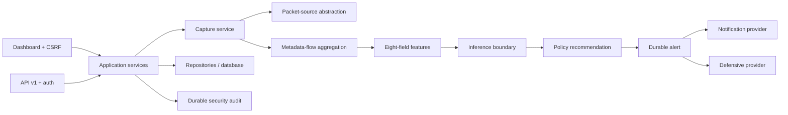

# Architecture

## System Boundary

AI Network Security 1.0.0 is a Flask application with a server-rendered dashboard,
versioned JSON API, SQLAlchemy persistence, and bounded process-local monitoring.
Dependencies point inward from routes to application services, domain services,
repositories, and provider abstractions. The dependency container constructs
services; startup does not capture, infer, notify, or block.

## Package Boundaries

- `config` owns environment input and fail-closed validation.
- `backend` owns composition, API routes, middleware, readiness, and CLI.
- `dashboard` owns HTML views and explicit operator workflows.
- `network` owns packet-source abstractions, bounded queues, immutable metadata
  flows, features, and live evaluation state.
- `ai` owns schemas, deterministic preprocessing, model registry, evaluation, and
  inference. It does not own capture or operational side effects.
- `alerts`, `notifications`, and `defense` own policies, durable records,
  provider boundaries, confirmation tokens, and idempotency.
- `auth` owns accounts, password verification, roles, authorization, and audit.
- `database` owns models, repositories, sessions, and explicit migrations.

## Capture and Metadata

Exactly one process may own capture. `CaptureService` accepts an approved packet
source (`scapy` or gated `fake`) and retains bounded packet metadata, never raw
payloads. Native interface identifiers remain inside the capture boundary and are
represented externally by opaque interface keys.

A flow key is `(opaque interface key, normalized protocol, normalized direction,
UTC window bucket)`. It is not a five-tuple. Immutable records contain safe IDs,
timestamps, counts and packet-size statistics, completion reason, source mode,
capture-session ID, and schema version. Bounds cover queue size, packet count,
duration, active/completed histories, and processing batch.

The authoritative inference vector is:

`duration`, `packet_count`, `byte_count`, `min_packet_size`,
`max_packet_size`, `avg_packet_size`, `protocol_enc`, `direction_enc`.

Invalid or empty flows produce incompatibility, not fabricated features.

## Explicit Boundaries

Processing drains only a server-selected bounded batch. Evaluation is separately
requested. Policy produces a recommendation. Alert creation, notification,
temporary deny, and deny removal each require a distinct authenticated POST and
CSRF/purpose-bound confirmation. No stage schedules the next.

## State and Idempotency

Durable state includes users, alerts, lifecycle changes, notification deliveries,
defensive actions, audit events, and migration revision. Database uniqueness and
transactions protect replay-sensitive effects.

Process-local state includes interfaces, capture ownership, packet metadata,
active/completed flow history, evaluation history, counters, and locks. It is
bounded, not shared between workers, and lost on restart. Multiple workers may
serve durable views, but live capture requires one declared owner.

## Authentication and Providers

Flask cookie sessions identify locally provisioned users. Viewer is read-only;
operator can run approved operational workflows; admin manages accounts and
administration. Session renewal, logout clearing, CSRF, safe redirects, role
checks, and audit records protect the browser boundary.

Notification and defensive-action providers are injected abstractions. Fake
providers are deterministic and development/testing-only. Production validates
provider configuration and never executes a real firewall command supplied by
this repository.

## Deployment and Lifecycle

Gunicorn loads `wsgi:app`; the Docker image runs as a non-root user. Migrations
are a separate operator step. `/health/live` reports process life and
`/health/ready` checks configuration, database, migration, and runtime
capabilities without mutation. Shutdown stops owned capture safely; there are no
processing workers or schedulers to drain. Request IDs correlate structured logs.
